# Rewear Database Proposal — Draft

> Trạng thái: **Draft — chưa triển khai schema mới; dev dùng synchronize, chưa làm migration**
>
> Nguồn nghiệp vụ: báo cáo TLCN và các màn hình Figma đang trong quá trình hoàn thiện.  
> Mục tiêu: thống nhất mô hình dữ liệu lõi để đội dự án review trước khi triển khai.

Quyết định đã xác nhận ngày 21/10/2026 nằm trong [CHECKOUT_DECISIONS.md](CHECKOUT_DECISIONS.md). ERD và phần chữ đã đối chiếu với các quyết định hiện có. Bảng mới là thiết kế đề xuất, chưa phải entity/API đã triển khai; các chính sách còn mở không được suy ra từ tên bảng.

## 1. Nguyên tắc thiết kế

- Một tài khoản có thể đồng thời mua và bán. `users.role` chỉ giữ vai trò hệ thống `USER` và `ADMIN`.
- Vai trò trong cửa hàng (`OWNER`, `STAFF`) thuộc `shop_members`, không đưa vào `users.role`.
- Một sản phẩm quần áo cũ là một món hàng duy nhất. Giỏ hàng không lưu số lượng; mỗi sản phẩm chỉ xuất hiện một lần trong cùng giỏ, nhưng có thể được nhiều buyer lưu vào giỏ riêng.
- Sản phẩm và đơn hàng thuộc một trong hai nguồn bán: cá nhân hoặc cửa hàng. Hai khóa ngoại nullable cùng với `CHECK` giúp giữ được FK thật trong database.
- Dữ liệu hiển thị trong đơn hàng phải được snapshot để lịch sử không thay đổi khi người bán sửa sản phẩm hoặc người mua sửa địa chỉ.
- Ảnh/video dùng chung bảng `media`; quan hệ đến nghiệp vụ nằm trong `media_links` để không phải tạo nhiều bảng ảnh giống nhau.
- Các trạng thái được mô tả ở mức khái niệm. Chỉ khóa enum khi luồng nghiệp vụ được duyệt.

## 2. Phạm vi đề xuất

### Nhóm A — Nền tảng và đăng bán

| Bảng             | Trách nhiệm chính                                     | Ghi chú                               |
| ---------------- | ----------------------------------------------------- | ------------------------------------- |
| `users`          | Tài khoản, hồ sơ cơ bản, vai trò hệ thống, trạng thái | Đã có                                 |
| `auth_tokens`    | Token xác thực email/đặt lại mật khẩu                 | Đã có                                 |
| `refresh_tokens` | Phiên đăng nhập dài hạn                               | Đã có                                 |
| `user_addresses` | Sổ địa chỉ nhận hàng                                  | Một địa chỉ mặc định mỗi user         |
| `categories`     | Danh mục sản phẩm                                     | MVP dùng danh mục phẳng               |
| `shops`          | Hồ sơ cửa hàng                                        | Không gắn role shop vào `users`       |
| `shop_members`   | Thành viên và vai trò trong cửa hàng                  | `OWNER` hoặc `STAFF`                  |
| `products`       | Nội dung đăng bán, thuộc tính và trạng thái món hàng  | Thuộc cá nhân hoặc shop               |
| `media`          | Metadata của file đã tải lên                          | Không chứa nghiệp vụ owner            |
| `media_links`    | Gắn media vào product, dispute, shipment...           | Quan hệ owner được kiểm tra ở service |

### Nhóm B — Mua hàng và hoàn tất đơn

| Bảng                   | Trách nhiệm chính                             | Ghi chú                                                                            |
| ---------------------- | --------------------------------------------- | ---------------------------------------------------------------------------------- |
| `carts`                | Giỏ hiện tại của người mua                    | Một cart hoạt động mỗi user                                                        |
| `cart_items`           | Các món trong giỏ                             | Không có `quantity`                                                                |
| `checkout_groups`      | Nhóm order thanh toán chung của buyer         | Một địa chỉ và deadline giữ 10 phút chung                                          |
| `orders`               | Giao dịch giữa một người mua và một nguồn bán | Lưu snapshot địa chỉ và tổng tiền                                                  |
| `order_items`          | Snapshot sản phẩm trong đơn                   | Cho phép nhiều món cùng nguồn bán                                                  |
| `order_status_history` | Nhật ký chuyển trạng thái đơn                 | Hỗ trợ audit và timeline UI                                                        |
| `shipments`            | Thông tin giao hàng và mã vận đơn             | Một shipment giao đi/đơn; shipment trả riêng                                       |
| `payment_transactions` | Các lần thử thanh toán và hoàn tiền           | Thanh toán theo nhóm checkout; phân bổ theo order cho tác vụ tiền còn cần thiết kế |

nghiên cứu về idempotency của stripe, các nền tảng thanh toán VN, https://developer.sepay.vn/,...

### Nhóm C — Sau mua hàng và trao đổi

| Bảng                        | Trách nhiệm chính                          | Ghi chú                            |
| --------------------------- | ------------------------------------------ | ---------------------------------- |
| `disputes`                  | Khiếu nại/đổi trả của một đơn              | MVP tối đa một case đang mở/đơn    |
| `reviews`                   | Đánh giá từ giao dịch đã hoàn tất          | Một review/order item              |
| `conversations`             | Hội thoại liên quan sản phẩm hoặc đơn hàng | Ngữ cảnh là nullable FK            |
| `conversation_participants` | Thành viên hội thoại                       | Dùng được cho buyer, seller, staff |
| `messages`                  | Nội dung tin nhắn                          | Media đính kèm qua `media_links`   |

## 3. Quan hệ tổng quát

```mermaid
erDiagram
    USERS ||--o{ USER_ADDRESSES : has
    USERS ||--o{ AUTH_TOKENS : owns
    USERS ||--o{ REFRESH_TOKENS : owns
    USERS ||--o{ SHOP_MEMBERS : joins
    SHOPS ||--o{ SHOP_MEMBERS : has
    CATEGORIES ||--o{ PRODUCTS : classifies
    USERS o|--o{ PRODUCTS : sells_directly
    SHOPS o|--o{ PRODUCTS : lists
    USERS ||--o| CARTS : owns
    CARTS ||--o{ CART_ITEMS : contains
    PRODUCTS ||--o{ CART_ITEMS : selected
    USERS ||--o{ CHECKOUT_GROUPS : checks_out
    CHECKOUT_GROUPS ||--|{ ORDERS : groups
    CHECKOUT_GROUPS ||--o{ RESERVATIONS : holds
    PRODUCTS ||--o{ RESERVATIONS : reserved_history
    USERS o|--o{ ORDERS : sells_directly
    SHOPS o|--o{ ORDERS : fulfills
    ORDERS ||--|{ ORDER_ITEMS : contains
    PRODUCTS o|--o{ ORDER_ITEMS : source_snapshot
    ORDERS ||--o{ ORDER_STATUS_HISTORY : records
    ORDERS ||--o{ SHIPMENTS : outbound_or_return
    CHECKOUT_GROUPS ||--o{ PAYMENT_TRANSACTIONS : attempts
    PAYMENT_TRANSACTIONS ||--o{ PAYMENT_ALLOCATIONS : allocates
    ORDERS ||--o{ PAYMENT_ALLOCATIONS : receives
    ORDERS ||--o{ REFUND_OPERATIONS : refunds
    PAYMENT_TRANSACTIONS ||--o{ REFUND_OPERATIONS : refunds_original
    REFUND_OPERATIONS ||--|{ REFUND_LINES : details
    ORDER_ITEMS o|--o{ REFUND_LINES : item_or_shipping
    ORDERS ||--o{ DISPUTES : cases
    DISPUTES ||--|{ DISPUTE_ITEMS : scope
    ORDER_ITEMS ||--o{ DISPUTE_ITEMS : disputed
    DISPUTES o|--o{ REFUND_OPERATIONS : authorizes_when_required
    ORDERS o|--o{ VENDOR_LEDGER_ENTRIES : settlement_history
    VENDOR_ACCOUNTS ||--o{ VENDOR_LEDGER_ENTRIES : records
    VENDOR_ACCOUNTS ||--o{ WITHDRAWAL_REQUESTS : requests
    WITHDRAWAL_REQUESTS o|--o{ VENDOR_LEDGER_ENTRIES : reserves_or_pays
    SYSTEM_SETTING_VERSIONS o|--o{ CHECKOUT_GROUPS : policy_snapshot
    ORDER_ITEMS ||--o| REVIEWS : receives
    USERS ||--o{ REVIEWS : writes
    CONVERSATIONS ||--o{ CONVERSATION_PARTICIPANTS : includes
    USERS ||--o{ CONVERSATION_PARTICIPANTS : participates
    CONVERSATIONS ||--o{ MESSAGES : contains
    USERS ||--o{ MESSAGES : sends
    MEDIA ||--o{ MEDIA_LINKS : linked_as
```



`media_links.owner_type + owner_id` là liên kết đa hình nên database không thể tạo FK trực tiếp tới mọi loại owner. Service phải kiểm tra owner tồn tại, quyền truy cập và xóa liên kết khi owner bị xóa.

## 4. Cột lõi đề xuất

Các bảng đều dùng UUID, `created_at`, `updated_at`; thêm `deleted_at` khi quy tắc lưu trữ cần soft delete.

### `user_addresses`

- `id`, `user_id`
- `label`, `recipient_name`, `phone`
- `address_line_1`, `address_line_2`
- `country_code`
- `province_code`, `province_name`
- `ward_code`, `ward_name`
- `postal_code`, `delivery_instructions`
- `is_default`

Ràng buộc: index theo `user_id`; partial unique index để mỗi user chỉ có tối đa một địa chỉ mặc định. Không lưu mã riêng của đơn vị vận chuyển tại đây. Khi tạo đơn, địa chỉ phải được snapshot vào đơn hàng.

### `shops` và `shop_members`

- `shops`: `id`, `name`, `description`, `status`
- `shop_members`: `shop_id`, `user_id`, `member_role`, `status`, `joined_at`

Ràng buộc:

- `UNIQUE (shop_id, user_id)`.
- Partial unique index bảo đảm một `OWNER` đang hoạt động cho mỗi shop.

### `products`

- `id`, `category_id`
- `seller_user_id` nullable, `shop_id` nullable
- `title`, `description`
- `condition`, `size`, `color`, `brand`
- `price`, `status`
- `published_at`, `held_until`, `sold_at`

Ràng buộc quan trọng:

```sql
CHECK ((seller_user_id IS NOT NULL)::int + (shop_id IS NOT NULL)::int = 1)
CHECK (price > 0)
```

Không thêm `quantity` ở MVP. Trạng thái dự kiến gồm nháp, chờ duyệt, đang bán, đang giữ chỗ, đã bán, ẩn và bị từ chối; tên enum cuối cùng cần theo state diagram đã duyệt.

### `media` và `media_links`

- `media`: `id`, `uploaded_by_id`, `url`, `media_type`, timestamps
- `media_links`: `id`, `media_id`, `owner_type`, `owner_id`, `role`, `sort_order`

Ví dụ `owner_type`: `PRODUCT`, `DISPUTE`, `SHIPMENT`, `MESSAGE`.  
Ví dụ `role`: `GALLERY`, `EVIDENCE`, `RECEIPT`, `ATTACHMENT`.

### `carts` và `cart_items`

- `carts`: `id`, `user_id`
- `cart_items`: `id`, `cart_id`, `product_id`, `added_at`

Ràng buộc:

- `UNIQUE (user_id)` trên `carts`.
- `UNIQUE (cart_id, product_id)`; không unique product_id toàn hệ thống vì nhiều buyer được lưu cùng món.

Đã chốt: thêm giỏ không giữ hàng. Khi checkout, loại món hết khả dụng khỏi giỏ/lượt mua và tiếp tục món hợp lệ; báo rõ kết quả cho buyer.

### Nhóm checkout và reservation — thiết kế sơ bộ

- `checkout_groups`: buyer, trạng thái, idempotency key, địa chỉ snapshot, tổng tiền và một deadline giữ 10 phút chung. Một nhóm có nhiều order theo nguồn bán, buyer thanh toán một lần. Tên cột chi tiết chưa phải contract cuối.
- Reservation có định danh/chủ sở hữu và liên kết nhóm checkout; conditional update giữ món còn khả dụng trong PostgreSQL. Không chỉ lưu heldUntil thiếu định danh reservation.
- Retry cùng lượt trả lại kết quả/deadline cũ, không gia hạn; đổi danh sách hủy/nhả lượt cũ rồi kiểm tra lại cho lượt mới. Hủy/hết hạn chỉ nhả reservation còn hợp lệ; lỗi hệ thống rollback, không xóa giỏ như lỗi hết hàng.
- HELD chặn seller sửa giá/nội dung/ảnh/trạng thái. Snapshot giá khi giữ hàng; UI hiển thị rõ giá/tổng, không thêm hộp xác nhận riêng cho thay đổi giá trước khi giữ.

### `orders` và `order_items`

- `orders`: `id`, `order_number`, `buyer_id`, `checkout_group_id`
- `seller_user_id` nullable, `shop_id` nullable
- `status`, `payment_method`
- `subtotal`, `shipping_fee`, `discount_amount`, `total_amount`
- `shipping_address_snapshot` JSONB
- `placed_at`, `cancelled_at`, `completed_at`
- `order_items`: `id`, `order_id`, `product_id` nullable
- `product_title_snapshot`, `product_attributes_snapshot` JSONB
- `unit_price_snapshot`, `quantity`

Ràng buộc:

- `orders` dùng cùng quy tắc “đúng một nguồn bán” như `products`.
- `quantity = 1` cho hàng secondhand duy nhất.
- `total_amount = subtotal + shipping_fee - discount_amount` được kiểm tra ở application service; có thể thêm DB `CHECK` khi công thức giá được khóa.
- `product_id` có thể `SET NULL`; snapshot giữ lịch sử khi listing không còn hiển thị.

Mỗi order chỉ chứa sản phẩm của cùng một cá nhân hoặc shop; checkout nhiều nguồn bán tạo nhiều order thuộc cùng checkout_group. Dùng một địa chỉ nhận chung, snapshot vào từng order; tính phí riêng từng nguồn bán rồi cộng vào tổng thanh toán. Chặn mua sản phẩm của chính buyer hoặc shop buyer sở hữu.

### `order_status_history`

- `id`, `order_id`, `from_status`, `to_status`
- `changed_by_id` nullable
- `note`, `created_at`

Mọi thay đổi trạng thái phải ghi cùng transaction với cập nhật `orders.status`.

### `shipments`

- `id`, `order_id`
- `carrier`, `tracking_code`, `status`
- Snapshot mã nhà cung cấp, định danh tài khoản tích hợp của sàn và điểm lấy hàng theo nguồn bán, bên trả cước và cước quote/thực tế; shop_id GHN nằm trong mapping adapter; không chứa token/secret trong snapshot
- Theo SHIPPING-02, sàn trả cước cho đơn vị vận chuyển; phí buyer trả sàn không được cộng vào khoản quyết toán tiền hàng vendor
- `shipped_at`, `delivered_at`

Ảnh biên nhận được gắn qua `media_links`, không cần bảng ảnh riêng.

### `payment_transactions`

Theo PAY-05, thu tiền ngay cho toàn checkout và chỉ ghi đã thu khi có xác nhận thanh toán hợp lệ. Lưu phân bổ theo order để refund riêng order bị seller từ chối/quá hạn, không hủy khoản phải trả của order khác. Rewear giữ số dư vendor chờ quyết toán; tách thanh toán thành công, lịch đối soát merchant và số dư có thể rút.

- `id`, `checkout_group_id`; liên kết/phân bổ `order_id` cho refund/chi seller còn cần thiết kế theo quyết định tiền
- `transaction_type`, `provider`, `method`
- `amount`, `currency`, `status`
- `external_reference`, `idempotency_key`
- `expires_at`, `processed_at`

Event thanh toán cần lưu định danh, kết quả xác minh, thời điểm và dữ liệu đã lọc để chống xử lý trùng; không lưu secret hoặc toàn bộ payload nhạy cảm.

Ràng buộc: unique có điều kiện cho `provider + external_reference` và `idempotency_key`. Không lưu secret, chữ ký hoặc toàn bộ payload nhạy cảm của cổng thanh toán.

### Số dư và yêu cầu rút — phạm vi bổ sung

Theo SETTLEMENT-01/WITHDRAW-01, tách tiền chờ quyết toán, số dư có thể rút và tiền chờ rút. Vendor gom tiền nhiều order, chọn tài khoản nhận và tạo yêu cầu rút; lưu lịch sử cộng/trừ cùng liên kết order/yêu cầu, snapshot đích nhận và reference chi tiền. WITHDRAW-02 chọn admin chuyển tiền bên ngoài và ghi reference/chứng từ, actor/thời điểm xử lý; tên bảng/cột chưa chốt; không chỉ sửa một trường balance thiếu lịch sử.

Theo WITHDRAW-03, hủy yêu cầu chỉ hợp lệ khi Chờ xử lý; hủy và admin nhận xử lý dùng cùng điều kiện trạng thái nguyên tử, lưu lịch sử hoàn số dư đúng một lần.

### Phân bổ, hoàn tiền và sổ số dư — tên bảng dự kiến

- `payment_allocations`: liên kết lần thu tiền thành công với từng order, tách tiền hàng/phí giao; unique theo payment/order. Không tạo nghĩa vụ chi tiền cho mỗi attempt thất bại.
- `refund_operations`: giao dịch thu gốc, order, hồ sơ xử lý nếu có, số tiền, reference/idempotency và kết quả cổng. Hủy trước giao có thể refund mà không có dispute.
- `refund_lines`: phân bổ theo order item hoặc khoản ship; tổng dòng bằng tổng operation, tổng refund xác nhận không vượt khoản đã thu còn lại. Dòng ship không bắt buộc có order item; chỉ hoàn khi chính sách/phán quyết cho phép.
- `dispute_items`: danh sách order item trong hồ sơ và kết quả theo món; các item phải thuộc order của hồ sơ.
- `vendor_accounts`: thuộc đúng cá nhân bán hoặc shop; không mặc định tài khoản cá nhân của staff sở hữu tiền shop. Ma trận quyền rút còn cần chốt.
- `vendor_ledger_entries`: lịch sử tiền chờ quyết toán, có thể rút, chờ rút và các điều chỉnh hợp lệ. Liên kết account bắt buộc; order hoặc withdrawal nullable theo loại sự kiện. Entry giữ/rút có thể gom nhiều order, không bắt buộc một entry luôn thuộc một order. Ghi bất biến và chống xử lý trùng; balance cache không thay lịch sử.
- `withdrawal_requests`: account, số tiền, đích nhận snapshot, trạng thái, người xử lý, reference/chứng từ và thời điểm. Vendor hủy chỉ khi pending; admin processing và vendor cancel cạnh tranh nguyên tử.
- `system_setting_versions`: giá trị cấu hình có phiên bản và audit; order/checkout/hồ sơ lưu giá trị và deadline đã áp dụng. Không bắt buộc runtime đọc cấu hình mới để tính lại giao dịch cũ.

Cardinality là lịch sử: một listing có nhiều reservation qua các lượt mua, nhưng chỉ một reservation hiệu lực; một order có thể có nhiều shipment cho giao đi/trả về, nhưng MVP chỉ một shipment giao đi. Tối đa một dispute đang mở/order, không giới hạn lịch sử chỉ một hồ sơ. FK giữa các item/order/refund phải được kiểm tra cùng phạm vi trong transaction.

### `disputes`

RETURN-01 yêu cầu lưu danh sách order item bị khiếu nại/được trả và số tiền hoàn tương ứng; không chỉ lưu một tổng refund thiếu phân bổ. Các món ngoài phạm vi giữ nguyên; phí ship/hoa hồng khi hoàn một phần và cách giải phóng tiền trong order còn mở. Tên bảng/cột chi tiết hoàn thiện khi triển khai.

- `id`, `order_id`, `opened_by_id`
- `reason`, `description`, `status`
- `resolution`, `resolved_by_id`, `resolved_at`

Bằng chứng ảnh/video đi qua `media_links`. Chỉ thêm bảng `dispute_events` nếu nghiệp vụ yêu cầu audit đầy đủ từng trao đổi và quyết định.

RETURN-02 bổ sung khoản giữ cước đi/về sau khi xác định lỗi vendor trong hồ sơ khiếu nại; lưu tách biệt với tiền hàng và liên kết quyết định/vận đơn. Giữ tiền, khấu trừ thực tế và nhả phần dư là các thao tác có lịch sử/idempotency riêng; nguồn bù khi thiếu số dư và phân bổ cước cho trả từng món còn mở.

RETURN-03 lưu tiền hoàn theo item và yêu cầu hoàn ship/định danh admin duyệt/lý do/số tiền riêng. Trả một phần không tự hoàn ship; cước vendor chịu không thu trùng phần buyer đã trả. Trả toàn bộ do lỗi vendor hoàn cả tiền hàng và ship. RETURN-04: lỗi buyer đã xác minh không tạo refund hoặc khoản giữ cước vendor; trạng thái order hoàn tất không tự mở tiền trước 72 giờ.

RETURN-05: hồ sơ trả hàng lưu thời điểm bắt đầu/hết hạn phản hồi (24 giờ), chấp thuận và hạn gửi trả (3 ngày), giao trả thành công từ đơn vị vận chuyển và hạn xác nhận vendor (48 giờ), cùng cấu hình đã áp dụng. Theo dõi escalation admin riêng, không ghi nhận refund chỉ vì hết hạn xác nhận.

### `reviews`

- `id`, `order_item_id`, `buyer_id`
- `rating`, `content`
- `seller_reply`, `replied_at`

Ràng buộc: `UNIQUE (order_item_id)`, `CHECK (rating BETWEEN 1 AND 5)`. Service xác minh buyer sở hữu order và order đã hoàn tất.

### `conversations`, `conversation_participants`, `messages`

- `conversations`: `id`, `product_id` nullable, `order_id` nullable, `last_message_at`
- `conversation_participants`: `conversation_id`, `user_id`, `last_read_at`
- `messages`: `id`, `conversation_id`, `sender_id`, `message_type`, `content`, `sent_at`

Ràng buộc: `UNIQUE (conversation_id, user_id)`. Một conversation có thể bắt đầu từ sản phẩm rồi gắn thêm order sau checkout.

## 5. Index cần có từ đầu

- `users(email)` unique.
- `products(status, category_id, published_at DESC)` cho catalog.
- `products(seller_user_id, status)` và `products(shop_id, status)` cho trang quản lý bán hàng.
- `cart_items(cart_id)` và `cart_items(product_id)`.
- `orders(buyer_id, created_at DESC)`.
- `orders(seller_user_id, status, created_at DESC)`.
- `orders(shop_id, status, created_at DESC)`.
- `order_status_history(order_id, created_at)`.
- `orders(checkout_group_id)` và `payment_transactions(checkout_group_id, created_at DESC)`; index cho phân bổ tiền theo order bổ sung khi chốt mô hình.
- `messages(conversation_id, sent_at DESC)`.
- `media_links(owner_type, owner_id, role, sort_order)`.

## 6. Trình tự triển khai

1. Giữ nguyên `users`, `auth_tokens`, `refresh_tokens` đang có.
2. Tạo `user_addresses`, `categories`, `shops`, `shop_members`.
3. Tạo `products`, `media`, `media_links`; hoàn thiện luồng đăng bán và catalog.
4. Tạo `carts`, `cart_items` theo CART-01; không reserve lúc thêm giỏ.
5. Tạo `checkout_groups`, reservation, `orders`, `order_items`, `order_status_history`, `shipments` theo quyết định đã chốt.
6. Tạo `payment_transactions` sau khi chọn cổng thanh toán và luồng COD/online.
7. Tạo `disputes`, `reviews` khi quy tắc sau mua được duyệt.
8. Tạo nhóm messaging khi chốt phạm vi chat realtime và chính sách lưu trữ.

Giai đoạn dev hiện tại dùng entity/synchronize theo DEV-01, chưa làm migration. Trước môi trường có dữ liệu cần bảo toàn, đánh giá migration/baseline bằng task riêng.

## 7. Quyết định và phần còn mở trước triển khai

1. Đã chốt: chỉ giữ khi checkout; 10 phút chung/lượt, không gia hạn; món hết khả dụng bị loại để tiếp tục món hợp lệ.
2. Đã chốt: nhiều order theo nguồn bán thuộc một checkout_group, thanh toán một lần; một địa chỉ chung và phí vận chuyển riêng từng nguồn bán.
3. Đã chốt seller có 24 giờ xác nhận (SELLER-01); còn mốc bắt đầu; từng seller từ chối/quá hạn hủy và refund riêng order theo PAY-05.
4. Sản phẩm có bắt buộc admin duyệt trước khi hiển thị và khi chỉnh sửa không? //TODO --> sort theo mức uy tín shop
5. Đã chốt MVP chỉ online sandbox, chưa COD (PAY-02). Không giới hạn một cổng (PAY-04); còn kiểm chứng danh sách phương thức/API, hoàn thiện quy trình refund/chi seller theo quyết định dòng tiền.
6. Đã chốt sàn quản lý tài khoản vận chuyển, điểm lấy hàng theo nguồn bán và trả cước (SHIPPING-02); GHN là hướng thử nghiệm ban đầu; triển khai API/webhook, không hybrid trong MVP. Còn quy tắc chênh lệch/hoàn phí ship buyer khi hủy/trả hàng.
7. Khiếu nại cho phép hoàn hàng, hoàn tiền một phần hay chỉ hoàn toàn bộ?
8. SETTLEMENT-01: cửa sổ khiếu nại 72 giờ từ giao thành công; chỉ mở số dư sau đủ hạn và không có tranh chấp. Buyer bấm hoàn tất sớm không mở tiền/mất quyền khiếu nại. Lưu delivered_at/deadline và thời điểm buyer xác nhận tách biệt; chi tiết trạng thái tự hoàn tất còn cần hoàn thiện.
9. Shop staff có những quyền cụ thể nào với sản phẩm, đơn hàng và chat?
10. Chính sách xóa/ẩn user, shop, product, message và thời gian lưu dữ liệu là gì?

Các con số như thời gian giữ hàng, thời gian seller xác nhận và cửa sổ khiếu nại nên nằm trong cấu hình nghiệp vụ, không hard-code vào schema.
Theo SETTINGS-01, thiết kế cấu hình nghiệp vụ do admin quản lý và lịch sử thay đổi; lưu snapshot phí/deadline trên giao dịch, không hồi tố đơn đang xử lý. Giá trị mặc định thời hạn là 10 phút/24 giờ/72 giờ; mức hoa hồng khởi tạo còn mở. Tên bảng/cột settings hoàn thiện khi triển khai.
