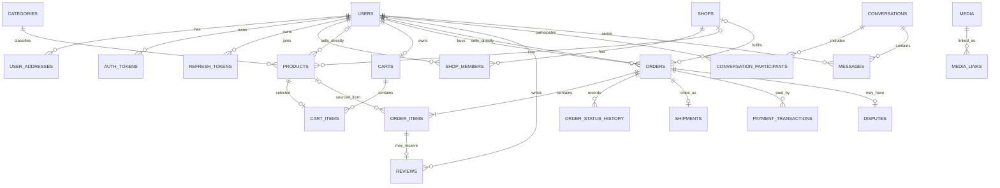

# Rewear Database Proposal — Draft

> Trạng thái: **Draft — chưa dùng để tạo migration**  
> Nguồn nghiệp vụ: báo cáo TLCN và các màn hình Figma đang trong quá trình hoàn thiện.  
> Mục tiêu: thống nhất mô hình dữ liệu lõi để đội dự án review trước khi triển khai.

## 1. Nguyên tắc thiết kế

- Một tài khoản có thể đồng thời mua và bán. `users.role` chỉ giữ vai trò hệ thống `USER` và `ADMIN`.
- Vai trò trong cửa hàng (`OWNER`, `STAFF`) thuộc `shop_members`, không đưa vào `users.role`.
- Một sản phẩm quần áo cũ là một món hàng duy nhất. Giỏ hàng không lưu số lượng; mỗi sản phẩm chỉ xuất hiện một lần.
- Sản phẩm và đơn hàng thuộc một trong hai nguồn bán: cá nhân hoặc cửa hàng. Hai khóa ngoại nullable cùng với `CHECK` giúp giữ được FK thật trong database.
- Dữ liệu hiển thị trong đơn hàng phải được snapshot để lịch sử không thay đổi khi người bán sửa sản phẩm hoặc người mua sửa địa chỉ.
- Ảnh/video dùng chung bảng `media`; quan hệ đến nghiệp vụ nằm trong `media_links` để không phải tạo nhiều bảng ảnh giống nhau.
- Các trạng thái được mô tả ở mức khái niệm. Chỉ khóa enum khi luồng nghiệp vụ được duyệt.

## 2. Phạm vi đề xuất

### Nhóm A — Nền tảng và đăng bán

| Bảng | Trách nhiệm chính | Ghi chú |
| --- | --- | --- |
| `users` | Tài khoản, hồ sơ cơ bản, vai trò hệ thống, trạng thái | Đã có |
| `auth_tokens` | Token xác thực email/đặt lại mật khẩu | Đã có |
| `refresh_tokens` | Phiên đăng nhập dài hạn | Đã có |
| `user_addresses` | Sổ địa chỉ nhận hàng | Một địa chỉ mặc định mỗi user |
| `categories` | Danh mục sản phẩm | MVP dùng danh mục phẳng |
| `shops` | Hồ sơ cửa hàng | Không gắn role shop vào `users` |
| `shop_members` | Thành viên và vai trò trong cửa hàng | `OWNER` hoặc `STAFF` |
| `products` | Nội dung đăng bán, thuộc tính và trạng thái món hàng | Thuộc cá nhân hoặc shop |
| `media` | Metadata của file đã tải lên | Không chứa nghiệp vụ owner |
| `media_links` | Gắn media vào product, dispute, shipment... | Quan hệ owner được kiểm tra ở service |

### Nhóm B — Mua hàng và hoàn tất đơn

| Bảng | Trách nhiệm chính | Ghi chú |
| --- | --- | --- |
| `carts` | Giỏ hiện tại của người mua | Một cart hoạt động mỗi user |
| `cart_items` | Các món trong giỏ | Không có `quantity` |
| `orders` | Giao dịch giữa một người mua và một nguồn bán | Lưu snapshot địa chỉ và tổng tiền |
| `order_items` | Snapshot sản phẩm trong đơn | Cho phép nhiều món cùng nguồn bán |
| `order_status_history` | Nhật ký chuyển trạng thái đơn | Hỗ trợ audit và timeline UI |
| `shipments` | Thông tin giao hàng và mã vận đơn | Một shipment/đơn trong MVP |
| `payment_transactions` | Các lần thử thanh toán và hoàn tiền | Một đơn có thể có nhiều attempt |

### Nhóm C — Sau mua hàng và trao đổi

| Bảng | Trách nhiệm chính | Ghi chú |
| --- | --- | --- |
| `disputes` | Khiếu nại/đổi trả của một đơn | MVP tối đa một case đang mở/đơn |
| `reviews` | Đánh giá từ giao dịch đã hoàn tất | Một review/order item |
| `conversations` | Hội thoại liên quan sản phẩm hoặc đơn hàng | Ngữ cảnh là nullable FK |
| `conversation_participants` | Thành viên hội thoại | Dùng được cho buyer, seller, staff |
| `messages` | Nội dung tin nhắn | Media đính kèm qua `media_links` |

## 3. Quan hệ tổng quát



`media_links.owner_type + owner_id` là liên kết đa hình nên database không thể tạo FK trực tiếp tới mọi loại owner. Service phải kiểm tra owner tồn tại, quyền truy cập và xóa liên kết khi owner bị xóa.

## 4. Cột lõi đề xuất

Các bảng đều dùng UUID, `created_at`, `updated_at`; thêm `deleted_at` khi quy tắc lưu trữ cần soft delete.

### `user_addresses`

- `id`, `user_id`
- `recipient_name`, `phone`
- `line_1`, `line_2`
- `ward`, `district`, `province`, `postal_code`
- `is_default`

Ràng buộc: partial unique index để mỗi user chỉ có một địa chỉ mặc định.

### `shops` và `shop_members`

- `shops`: `id`, `name`, `description`, `status`
- `shop_members`: `shop_id`, `user_id`, `member_role`, `status`, `joined_at`

Ràng buộc:

- `UNIQUE (shop_id, user_id)`.
- Partial unique index bảo đảm một `OWNER` đang hoạt động cho mỗi shop.

### `products`

- `id`, `category_id`
- `seller_user_id` nullable, `shop_id` nullable
- `title`, `description`
- `condition`, `size`, `color`, `brand`
- `price`, `status`
- `published_at`, `held_until`, `sold_at`

Ràng buộc quan trọng:

```sql
CHECK ((seller_user_id IS NOT NULL)::int + (shop_id IS NOT NULL)::int = 1)
CHECK (price >= 0)
```

Không thêm `quantity` ở MVP. Trạng thái dự kiến gồm nháp, chờ duyệt, đang bán, đang giữ chỗ, đã bán, ẩn và bị từ chối; tên enum cuối cùng cần theo state diagram đã duyệt.

### `media` và `media_links`

- `media`: `id`, `uploaded_by_id`, `url`, `media_type`, timestamps
- `media_links`: `id`, `media_id`, `owner_type`, `owner_id`, `role`, `sort_order`

Ví dụ `owner_type`: `PRODUCT`, `DISPUTE`, `SHIPMENT`, `MESSAGE`.  
Ví dụ `role`: `GALLERY`, `EVIDENCE`, `RECEIPT`, `ATTACHMENT`.

### `carts` và `cart_items`

- `carts`: `id`, `user_id`
- `cart_items`: `id`, `cart_id`, `product_id`, `added_at`

Ràng buộc:

- `UNIQUE (user_id)` trên `carts`.
- `UNIQUE (cart_id, product_id)` và `UNIQUE (product_id)` trên cart item đang hoạt động để một món duy nhất không nằm trong nhiều giỏ cùng lúc nếu sản phẩm được giữ chỗ ngay khi thêm giỏ.

Việc “thêm vào giỏ có giữ hàng hay không” chưa chốt. Nếu không giữ hàng tại bước này, bỏ `UNIQUE (product_id)` và chỉ khóa sản phẩm trong transaction checkout.

### `orders` và `order_items`

- `orders`: `id`, `order_number`, `buyer_id`
- `seller_user_id` nullable, `shop_id` nullable
- `status`, `payment_method`
- `subtotal`, `shipping_fee`, `discount_amount`, `total_amount`
- `shipping_address_snapshot` JSONB
- `placed_at`, `cancelled_at`, `completed_at`
- `order_items`: `id`, `order_id`, `product_id` nullable
- `product_title_snapshot`, `product_attributes_snapshot` JSONB
- `unit_price_snapshot`, `quantity`

Ràng buộc:

- `orders` dùng cùng quy tắc “đúng một nguồn bán” như `products`.
- `quantity = 1` cho hàng secondhand duy nhất.
- `total_amount = subtotal + shipping_fee - discount_amount` được kiểm tra ở application service; có thể thêm DB `CHECK` khi công thức giá được khóa.
- `product_id` có thể `SET NULL`; snapshot giữ lịch sử khi listing không còn hiển thị.

Mỗi order chỉ chứa sản phẩm của cùng một cá nhân hoặc shop. Một lần checkout có nhiều seller sẽ tạo nhiều order. Chưa cần `checkout_groups` cho đến khi UI cần một mã thanh toán tổng cho nhiều seller.

### `order_status_history`

- `id`, `order_id`, `from_status`, `to_status`
- `changed_by_id` nullable
- `note`, `created_at`

Mọi thay đổi trạng thái phải ghi cùng transaction với cập nhật `orders.status`.

### `shipments`

- `id`, `order_id`
- `carrier`, `tracking_code`, `status`
- `shipped_at`, `delivered_at`

Ảnh biên nhận được gắn qua `media_links`, không cần bảng ảnh riêng.

### `payment_transactions`

- `id`, `order_id`
- `transaction_type`, `provider`, `method`
- `amount`, `currency`, `status`
- `external_reference`, `idempotency_key`
- `expires_at`, `processed_at`

Ràng buộc: unique có điều kiện cho `provider + external_reference` và `idempotency_key`. Không lưu secret, chữ ký hoặc toàn bộ payload nhạy cảm của cổng thanh toán.

### `disputes`

- `id`, `order_id`, `opened_by_id`
- `reason`, `description`, `status`
- `resolution`, `resolved_by_id`, `resolved_at`

Bằng chứng ảnh/video đi qua `media_links`. Chỉ thêm bảng `dispute_events` nếu nghiệp vụ yêu cầu audit đầy đủ từng trao đổi và quyết định.

### `reviews`

- `id`, `order_item_id`, `buyer_id`
- `rating`, `content`
- `seller_reply`, `replied_at`

Ràng buộc: `UNIQUE (order_item_id)`, `CHECK (rating BETWEEN 1 AND 5)`. Service xác minh buyer sở hữu order và order đã hoàn tất.

### `conversations`, `conversation_participants`, `messages`

- `conversations`: `id`, `product_id` nullable, `order_id` nullable, `last_message_at`
- `conversation_participants`: `conversation_id`, `user_id`, `last_read_at`
- `messages`: `id`, `conversation_id`, `sender_id`, `message_type`, `content`, `sent_at`

Ràng buộc: `UNIQUE (conversation_id, user_id)`. Một conversation có thể bắt đầu từ sản phẩm rồi gắn thêm order sau checkout.

## 5. Index cần có từ đầu

- `users(email)` unique.
- `products(status, category_id, published_at DESC)` cho catalog.
- `products(seller_user_id, status)` và `products(shop_id, status)` cho trang quản lý bán hàng.
- `cart_items(cart_id)` và `cart_items(product_id)`.
- `orders(buyer_id, created_at DESC)`.
- `orders(seller_user_id, status, created_at DESC)`.
- `orders(shop_id, status, created_at DESC)`.
- `order_status_history(order_id, created_at)`.
- `payment_transactions(order_id, created_at DESC)`.
- `messages(conversation_id, sent_at DESC)`.
- `media_links(owner_type, owner_id, role, sort_order)`.

## 6. Trình tự triển khai

1. Giữ nguyên `users`, `auth_tokens`, `refresh_tokens` đang có.
2. Tạo `user_addresses`, `categories`, `shops`, `shop_members`.
3. Tạo `products`, `media`, `media_links`; hoàn thiện luồng đăng bán và catalog.
4. Tạo `carts`, `cart_items`; chốt thời điểm giữ hàng trước khi viết constraint cuối.
5. Tạo `orders`, `order_items`, `order_status_history`, `shipments`.
6. Tạo `payment_transactions` sau khi chọn cổng thanh toán và luồng COD/online.
7. Tạo `disputes`, `reviews` khi quy tắc sau mua được duyệt.
8. Tạo nhóm messaging khi chốt phạm vi chat realtime và chính sách lưu trữ.

Mỗi nhóm nên là một migration độc lập. Không tạo migration cho toàn bộ mô hình trong một lần.

## 7. Quyết định cần khóa trước migration

1. Thêm vào giỏ có giữ hàng hay chỉ giữ khi checkout?
2. Một checkout nhiều seller dùng nhiều order độc lập hay cần một `checkout_group` chung?
3. Seller có phải xác nhận đơn không; timeout và hành vi tự hủy là bao lâu?
4. Sản phẩm có bắt buộc admin duyệt trước khi hiển thị và khi chỉnh sửa không?
5. MVP hỗ trợ COD, thanh toán online hay cả hai? Refund do hệ thống hay admin thực hiện?
6. Shipping tích hợp hãng vận chuyển hay người bán tự nhập mã vận đơn?
7. Khiếu nại cho phép hoàn hàng, hoàn tiền một phần hay chỉ hoàn toàn bộ?
8. Cửa sổ khiếu nại và thời điểm order tự hoàn tất là bao lâu?
9. Shop staff có những quyền cụ thể nào với sản phẩm, đơn hàng và chat?
10. Chính sách xóa/ẩn user, shop, product, message và thời gian lưu dữ liệu là gì?

Các con số như thời gian giữ hàng, thời gian seller xác nhận và cửa sổ khiếu nại nên nằm trong cấu hình nghiệp vụ, không hard-code vào schema.
